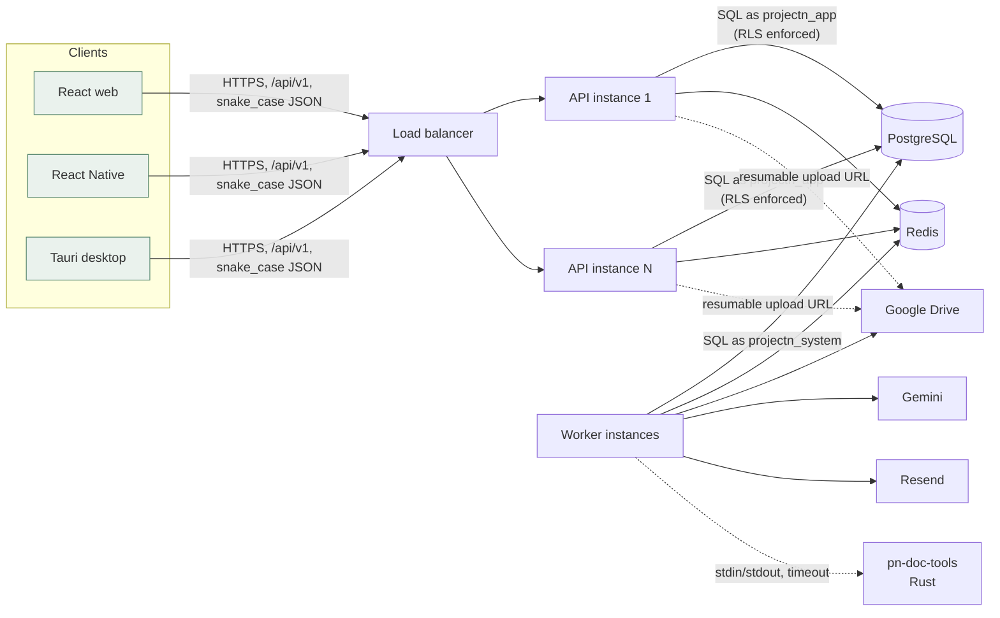
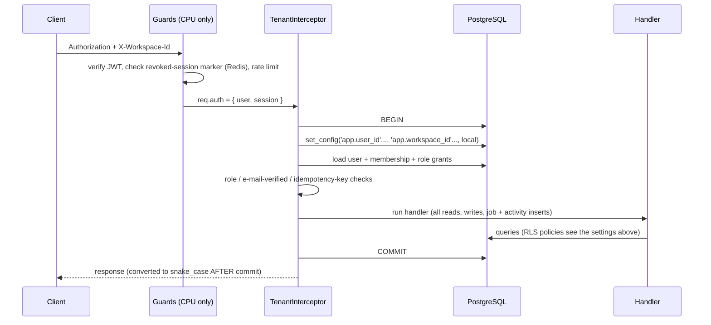

# Backend architecture

This document describes what was **built**. The product behaviour comes from `docs/project-tracking-system-overview.md` and `docs/ARCHITECTURE.md` at the repository root. That earlier document proposed FastAPI and Alembic; this backend implements the same product rules and API conventions in **NestJS, TypeScript, Prisma and PostgreSQL**, as requested. Deviations are listed at the end.

## 1. Shape of the system

A **modular monolith**: one codebase, one database, modules with narrow public surfaces (`src/modules/*`). Two deployables from one image:

| Deployable | Command | Scales by |
|---|---|---|
| API | `node dist/main.js` | adding stateless instances behind a load balancer |
| Worker | `node dist/worker.js` | adding instances (`FOR UPDATE SKIP LOCKED` keeps them apart) |

API instances hold **no session state** in memory. Access tokens are self-contained; revocation, rate limits and caches live in Redis (an in-process map is the fallback for one instance, dev, tests and the free demo, and the code says so at start-up).

## 2. One request, one transaction

Every authenticated request runs in **one** PostgreSQL transaction, opened by `TenantInterceptor`:

Consequences worth knowing:

* **Atomicity.** A business change, its activity-log row, its notifications and its queued jobs commit or roll back together (transactional outbox). A failed request leaves nothing behind (tested).
* **No context leakage.** `set_config(..., true)` is `SET LOCAL`: discarded at COMMIT/ROLLBACK, so a pooled connection never carries one tenant's identity into the next request (tested).
* **No external calls in the transaction path** except Drive folder/upload-session creation, which are short and bounded; AI, e-mail and file processing are always jobs.

## 3. Authorization: two independent layers

1. **Application policy** (`src/authz/policy.ts`): pure functions of `(caller, project facts)`. They produce the `viewer` capabilities returned with every project, and the 403/404 decisions.
2. **PostgreSQL** (`prisma/migrations/0002_*`): Row Level Security on every tenant table, driven by `SECURITY DEFINER` SQL functions (`pn_ws`, `pn_content_projects`, `pn_supervisor_projects`, `pn_supervisor_rights`, ...). The API connects as a role that **cannot bypass RLS** and refuses to start otherwise.

`test/contract.e2e-spec.ts` asserts that the TypeScript rules and the SQL rules **agree for every person × project × check**, so the two layers cannot silently drift. Access that the product forbids is blocked even when the application layer is wrong or absent:

| Rule from the brief | Enforced by |
|---|---|
| Tenant isolation | `workspace_id = pn_ws()` on every policy; `pn_ws()` returns the workspace only if the caller is an **active member** of it; composite foreign keys `(workspace_id, parent_id)` make cross-tenant references impossible |
| Private (supervisors-only) discussion | `comments` policy: invisible to anyone outside `pn_supervisor_projects()`; students also cannot `INSERT` one |
| Super Admin never sees project content | holds no membership, so every tenant policy returns nothing; admin endpoints use the system role and only touch metadata, counts, plans, usage and the job table (job payloads are never returned) |
| Institution Admin: structure and people, not content | content tables are visible only through `pn_content_projects()` (members and Dean/Head/Owner); the admin sees the `projects` row and the setup categories of the activity log |
| Append-only history | `activity_log`, `reviews`, `overrides`: no `UPDATE`/`DELETE` grant for the app role and a trigger that rejects both |
| Immutable submission versions | trigger rejects changes to version, author, time, note |
| Phase state machine | `BEFORE UPDATE` trigger allows only the transitions in the lifecycle diagram |
| One Lead, one group leader, one successor per project | partial unique indexes |
| Revocation reasons are leadership-only | policy on `approval_revocations`; everyone else learns only the boolean through `pn_supervisor_rights()` |

Role model: workspace roles live on a **membership** (`membership_roles`, Dean scoped to a faculty, Head to a department); project roles on `project_members` (Lead, Co-supervisor, Student, group leader flag). Roles stack. The Super Admin is a flag on the user.

## 4. Workflows (where the rules live)

| Workflow | Module | Notes |
|---|---|---|
| Sign-up, verify, login, refresh, sessions | `auth`, `me` | Argon2id; opaque refresh tokens stored as SHA-256; rotation with reuse detection (10 s grace for two tabs); account lock after 10 failures / 15 min |
| Institutions, faculties, departments, people, invites, CSV import | `org` | set-based import, row-numbered errors, one-time invite tokens |
| Projects, groups, leaders, succession | `projects`, `governance` | creation validated against the architecture rules; offboarding hands every project over in one transaction |
| Phase timeline, drafts, Drive uploads | `phases`, `drive` | files live in the **Lead's** Drive; only metadata in PostgreSQL; direct-to-Drive resumable uploads or small multipart through the API |
| Versioned submissions, reviews, approvals | `workflow` | phase row locked first (`FOR UPDATE`), then submission; unique indexes make double-decisions impossible; approval rights resolved in SQL |
| Extensions, Dean overrides | `workflow` | every override needs a reason, writes an immutable `overrides` row and an activity entry, notifies supervisors (and Admins when the Dean also supervises) |
| Comments, time logs, notifications | `collab`, `insights` | mentions resolved against who may read the comment |
| Activity log, calendar, reports | `insights` | keyset pagination; reports scoped by RLS and cached 60 s |
| AI feedback | `worker` | asynchronous, budget-checked, metered once per job, output validated and clipped |
| Health | `workflow/health.service.ts` | pure function (unit-tested) + event-driven and hourly recompute |
| Super Admin | `admin` | approve institutions, plans/budgets, usage, failed jobs |

## 5. Background jobs

`jobs` is a **durable queue in PostgreSQL**. `enqueue` inserts inside the caller's transaction. Workers claim with `UPDATE ... WHERE id IN (SELECT ... FOR UPDATE SKIP LOCKED)`, retry with backoff (1 min, 5 min, 30 min, 2 h, 6 h), and park exhausted jobs as `dead` (visible to the Super Admin, retryable). A job still `running` after 5 minutes belonged to a crashed worker and is reclaimed. Delivery is **at least once**, so every handler is idempotent:

| Handler | Why running it twice is safe |
|---|---|
| `email.send` | the provider idempotency key is the job id; delivered jobs are scrubbed of recipient and link |
| `ai.review_submission` | exits when `ai_status` is already `ready`; `ai_usage.job_id` is unique so it bills once; the result is an upsert |
| `health.recompute` | recomputes from facts; unchanged result writes nothing and alerts nothing |
| `reminders.deadlines` | one reminder per (phase, person, day-count), found by a dedupe key |
| `drive.*` | folder creation is find-or-create; deleting a missing file is success |
| scheduled jobs | inserted with `ON CONFLICT (dedupe_key) DO NOTHING`, so every worker may schedule every minute |

## 6. Why Rust, and only there

`rust/doc-tools` extracts text from student-supplied `.docx` files for AI review. A DOCX is a ZIP of XML from an untrusted source: zip bombs, entity expansion and large inputs are real. The helper:

* runs as a **separate process** with a hard timeout and output cap, so a hostile file can exhaust at most that process;
* enforces its limits **before** inflating (input ≤ 40 MiB, XML ≤ 64 MiB, ≤ 2,000 entries, output ≤ N characters, truncation on character boundaries);
* is memory-safe, fast, and keeps CPU-bound parsing off the Node event loop.

Everything else stays in Node/TypeScript: business rules, SQL, HTTP, jobs. Hashing (`argon2`) is already native code. No other Rust is justified today.

## 7. Clients and sessions

| Client | Refresh token | Access token |
|---|---|---|
| Web | httpOnly, Secure, SameSite=Lax cookie on `/api/v1/auth`; `refresh`/`logout` also need `X-Requested-With` (CSRF) | memory only |
| React Native / Tauri | `X-Client: native` makes the API return it in the body. Store it in the OS keychain (`expo-secure-store`, Keystore/Keychain, Tauri stronghold). Never AsyncStorage / localStorage. | memory only |

`packages/api-client` is generated from the OpenAPI document and implements both modes, single-flight refresh, workspace header injection and idempotency keys.

## 8. Deviations from the earlier design document

| Earlier document | This backend | Why |
|---|---|---|
| FastAPI, SQLAlchemy, Alembic | NestJS, Prisma, SQL migrations | requested stack |
| Jobs run in the API process, triggered by an external cron | Independent worker process; the in-process mode remains as `INLINE_WORKER` for the free demo | scale-out and isolation; the document anticipated this move |
| `slowapi` in-memory rate limits | Redis counters (memory fallback) | multi-instance correctness |
| Native enums as `text + CHECK` | Prisma/PostgreSQL enums | type safety end to end |
| Institution Admin may create projects | **Cannot** (frontend product decision, Oct 2026: admin runs structure and people only) | follows the newest decision; one constant to change |
| Former Lead keeps 30-day read access (D11, proposed) | not implemented | open decision, noted in STATUS.md |
